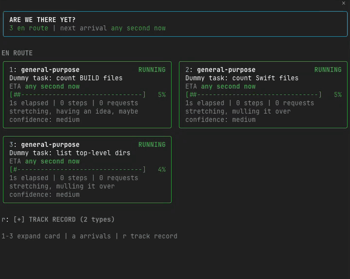
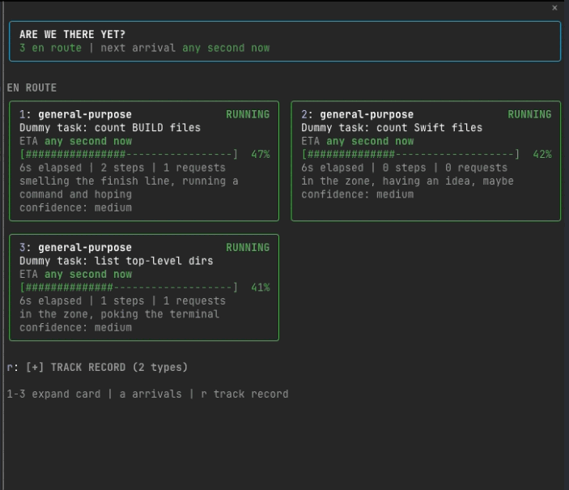
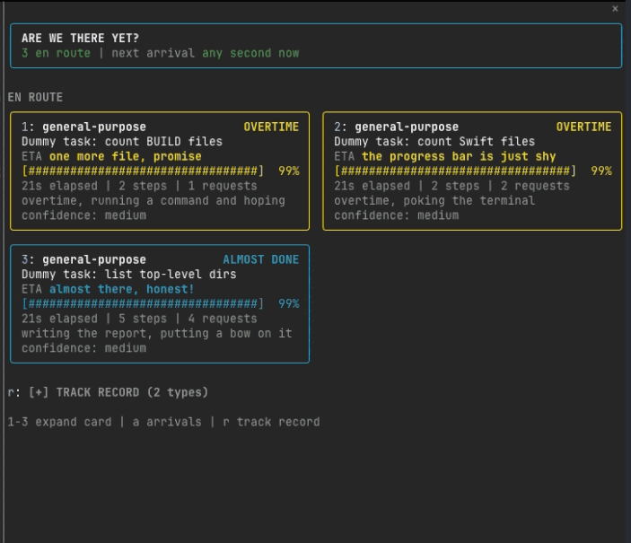
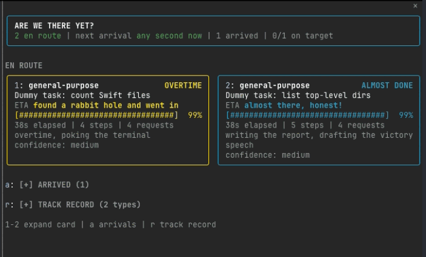

# Are we there yet?

A Claude Code mod for the back seat. Whenever Claude sends off a subagent, it guesses how long the subagent has left and keeps you posted in a side deck, one card per agent.



[Watch the demo as video (MP4)](docs/demo.mp4)

## Install

At the prompt of a terminal session:

```
/plugin install are-we-there-yet --marketplace rusha-mercari/are-we-there-yet
```

Answer `y` to add the marketplace, then pick a scope (user scope is first).

From a shell:

```bash
claude plugin install are-we-there-yet --marketplace rusha-mercari/are-we-there-yet
```

In the desktop app, where `/plugin` does not run: click + next to the prompt box, then Plugins, Add marketplace with `rusha-mercari/are-we-there-yet`, then Add plugin.

## What you see

**The deck** opens on its own when a subagent starts, or any time with `/eta`.

- A summary card: how many agents are en route, the next arrival, and how many guesses landed on target.
- **EN ROUTE**: a card per running agent with its type, task, an ETA range, a `[####------]` progress bar, elapsed time, steps, model requests, and a line on what it is up to. The status and border color say how it is going: green RUNNING, yellow OVERTIME, cyan ALMOST DONE.
- **ARRIVED** and **TRACK RECORD**: recent verdicts (ON TIME, EARLY, LATE, STOPPED, FAILED, VANISHED) and the learned averages per agent type. Both start collapsed.

| Running | Overtime and almost done | One arrived |
| --- | --- | --- |
|  |  |  |

**The band** above the prompt is one line: agents en route and the next arrival, with `deck` and `hide` buttons.

Keys while the deck has focus: `1`-`9` expand a card (recent tools, the start of its brief, the predicted total), `a` toggles arrivals, `r` toggles the track record.

## How it guesses

It starts from a typical duration per agent type, scaled by how long the task prompt is. As the agent works, it moves from trusting the clock to trusting its pace in steps, and the bar never moves backwards. When a subagent starts writing its final report (long prose with no tool call, or a `SubagentHandback` call), the card switches to ALMOST DONE. Every completed run updates a saved per-type average, so guesses improve over time.

## Fine print

It is a guess. Failed, stopped or vanished runs teach it nothing. Once an agent runs well past its estimate, the card switches to OVERTIME and offers excuses instead of numbers. Everything is drawn in plain ASCII so columns line up in any terminal.
